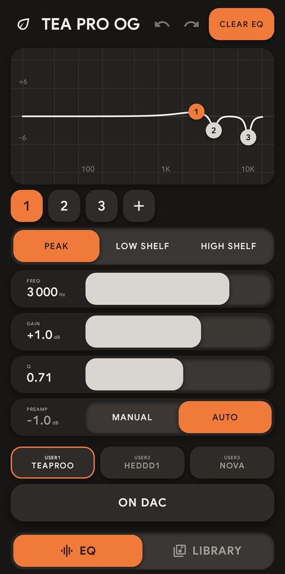
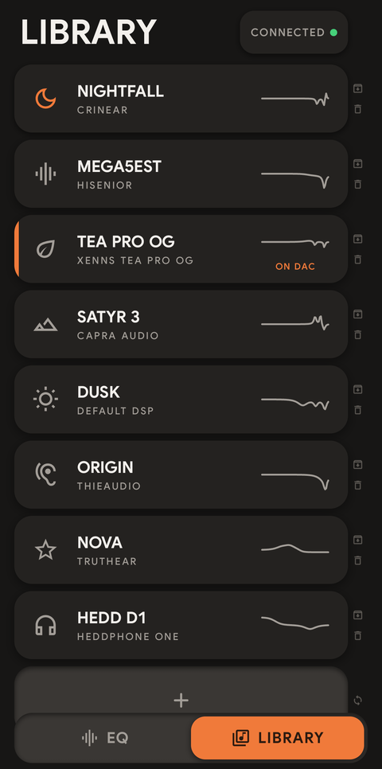

<p align="center"></p>

# Contour

**An on-the-go EQ manager for the CrinEar Protocol Micro and Max, FiiO KA15 and K13 R2R, SnowSky Melody and Tiny A, TRN Black Pearl, Moondrop Dawn Pro 2 and Echo-A, and Kiwi Ears Allegro Mini.** Keep all your EQ profiles on your phone, plug the
dongle in, pick one and send it. Plug in, send, unplug - that is the whole routine. On DACs with their own settings, a DAC page changes those from the phone too.

**Website: [contoureq.app](https://contoureq.app/)** - a 1.5-minute demo film, the full guide film and the install page.

<p align="center">
  
  &nbsp;&nbsp;
  
</p>

## Why it exists

All ten DACs Contour supports have a parametric EQ built into the DAC itself. Whatever EQ a DAC holds works with every
app and every device you plug it into - no system equaliser, no app running in the background. But
the official way to change it on the Protocol dongles is CrinEar's browser tool at [eq.hangout.audio](https://eq.hangout.audio/),
which the maker lists for desktop (PC and macOS) browsers. There is no official mobile app, and phone
browsers lack the WebHID support the tool relies on - so in practice you need a computer nearby.

Contour puts that on your phone. It is deliberately a small, simple tool:

- **Your EQs are saved.** One profile per pair of earphones, or per mood. They live on the phone, ready
  whenever the dongle is plugged in.
- **Sending takes seconds.** Plug the dongle in, tap a profile, hold HOLD TO SEND. Contour writes it, reads
  it back to check every value, and stores it in the dongle's memory.
- **Then the phone is out of the picture.** Unplug the dongle and use it with your laptop, another phone or
  anything else. The EQ stays in it until you send another one.
- **Real examples to start from.** The first launch includes NIGHTFALL, the maintainer's own tuning for
  the CrinEar Nightfall, and DUSK, the default curve of Moondrop's DSP cable for the Moondrop x Crinacle
  DUSK (so the analog cable sounds like the DSP one), next to a flat PROFILE 1.
- **You can still tune on the go.** Drag bands on the graph, fine-tune with sliders, paste an AutoEQ
  profile from the clipboard, or read the current EQ off the dongle.

Contour does not process audio, does not need the internet and has no accounts. It only talks to the dongle.

**Watch the [guide](https://contoureq.app/guide/)**: every function of the app in a 6-minute film, with chapters and the full text.

## Supported hardware

- **CrinEar Protocol Micro** (USB `3302:C20F`, WalkPlay chip): 8 bands, PEAK, LOW SHELF and HIGH SHELF, and since
  1.6.0 LOW PASS and HIGH PASS, gain -10 to +10 dB, Q 0.1 to 10, 20 Hz to 20 kHz, preamp -30 to 0 dB in whole dB.
  Since 1.6.0 the filters are computed for the 93 750 Hz the DAC's DSP runs at (before, every filter played about
  2% too low). The DAC accepts a positive preamp but does not get louder, so Contour offers none. Tested on the
  developer's own hardware, the EQ also measured on a test rig. Its settings, hardware volume and reset are not
  supported yet: they would need the maker's own tool (WalkPlay), which Contour has no access to.
- **CrinEar Protocol Max** (USB `3302:43CC`, WalkPlay chip): 10 bands, PEAK, LOW SHELF and HIGH SHELF as native filters,
  gain -10 to +10 dB, Q 0.1 to 10, 20 Hz to 20 kHz, preamp -30 to 0 dB in whole dB, computed and sent by the app.
  Tested by a Reddit community member on a real Protocol Max (8 bands, peak and shelf filters, no crashes).
  Large HIGH SHELF boosts at lower frequencies don't fit the Max's filter format; since 1.4.0 Contour refuses them
  with a message instead of sending them.
- **FiiO KA15** (USB `2972:0104`, FiiO protocol): 10 bands, PEAK, LOW SHELF and HIGH SHELF, and since 1.6.0 HIGH PASS,
  LOW PASS, BAND PASS and ALL PASS, gain -12 to +12 dB,
  Q 0.1 to 10 (shelves up to 7.07), 20 Hz to 20 kHz, preamp -24 to 0 dB. Pick USER1, USER2 or USER3 above HOLD TO
  SEND; Contour writes the profile to that slot and names the slot after it (up to 7 letters and digits). Long-press
  a slot to rename it. The KA15 answers only while audio is streaming to it, so Contour plays a silent stream to it
  while it reads or writes (no audio focus, your music keeps playing). Tested on the developer's own hardware.
  The KA15 plays its shelf filters with a Q 1.41 times lower than the value it stores, and every USER preset 12 dB
  quieter than EQ off. Since 1.3.3 Contour compensates both, so the curve and preamp you see are what it plays
  (measured on the device, see `research/protocol/PROTOCOL.md`). The FiiO app shows the stored values, so its
  shelf Q and preamp look higher. Since 1.6.0 a Q just outside the range is read instead of blocking the slot.
  The DAC page has VOLUME, VOLUME STEPS, BALANCE, FILTER, OUTPUT, DRE, BRIGHTNESS, SCREEN OFF, ROTATION and
  LANGUAGE (USB AUDIO is shown, read-only). FACTORY RESET first saves a copy of the USER slots, their names and
  the settings on the phone, then resets the DAC, shows what changed and offers WRITE THE SAVED COPY BACK.
- **FiiO K13 R2R** (USB `2972:0120`, FiiO protocol, desktop DAC/amp): 10 bands, PEAK, LOW SHELF and HIGH SHELF, and
  since 1.6.0 HIGH PASS, LOW PASS, BAND PASS and ALL PASS, gain -24 to +12 dB, Q 0.1 to 10, 20 Hz to 20 kHz, preamp -24 to +12 dB. Pick USER1 to USER10 above HOLD TO SEND;
  Contour writes the profile to that slot and makes it the active one. The slots keep their USER names (Contour
  does not rename K13 slots). The K13 always holds ten bands, so a shorter profile is filled up with flat 0 dB bands.
  Writes are paced 300 ms apart, so a send takes about five seconds: faster writes read back fine but did not
  survive turning the K13 off. BYPASS and the stock presets are chosen on the K13 itself. Tested on the developer's
  own hardware, the EQ also measured on a test rig. The K13 plays a PEAK with its Q divided by the square root of 2,
  so since 1.6.0 Contour writes Q x 1.41 and the PEAK plays as set. The K13 has no DAC page yet.
- **SnowSky Melody** (USB `2972:0126`, FiiO protocol): 10 bands, PEAK, LOW SHELF and HIGH SHELF, and since 1.6.0
  HIGH PASS, LOW PASS, BAND PASS and ALL PASS, gain -12 to +12 dB,
  Q 0.1 to 10, 20 Hz to 20 kHz, preamp -12 to +12 dB in whole dB. Pick USER1, USER2 or USER3 above HOLD TO SEND;
  Contour writes the profile to that slot, checks it and makes it the active one. The Melody always holds ten
  bands, so a shorter profile is filled up with flat 0 dB bands. Since 1.6.0 shelves play as set (Q written x 1.41,
  like on the KA15). The DAC page has VOLUME, VOLUME STEPS, BALANCE, FILTER, GAIN, OUTPUT, DRE, IN-LINE MIC, LIGHT
  and BUTTONS (USB AUDIO is shown, read-only). FACTORY RESET saves a copy first, as on the KA15; after the reset you
  unplug the DAC and plug it back in, and on the Melody Contour waits for that with no time limit (STOP WAITING ends the wait). Tested on the
  developer's own hardware, the EQ also measured on a test rig.
- **SnowSky Tiny A** (USB `2972:0147`, FiiO protocol): the same as the Melody - 10 bands, PEAK, shelves and, since
  1.6.0, the four pass filters, gain -12 to +12 dB, preamp -12 to +12 dB in whole dB, USER1, USER2 or USER3, shelves
  with Q x 1.41. Its DAC page has VOLUME, VOLUME STEPS, BALANCE, IN-LINE MIC and LIGHT (USB AUDIO read-only). It has
  no factory reset in Contour: the DAC (firmware 1.2.0) ignores the command. Tested on the developer's own hardware,
  the EQ also measured on a test rig.
- **TRN Black Pearl** (USB `3302:43E8`, WalkPlay chip): 10 bands, PEAK, LOW SHELF and HIGH SHELF as native filters,
  gain -10 to +10 dB, Q 0.1 to 10, 20 Hz to 20 kHz, preamp -30 to 0 dB in whole dB. **Plug your headphones into the
  Black Pearl first:** without headphones it does not show up on USB at all, so Contour shows NO DAC. Every send is
  read back and stays in the DAC after unplugging, preamp included. Since 1.6.0 shelves play as set (Q written
  x 1.41). Tested on the developer's own hardware, the EQ also measured on a test rig. LOW PASS, HIGH PASS, the DAC
  filter, settings, hardware volume and reset are not supported yet.
- **Moondrop Dawn Pro 2** (USB `35D8:011D`, USB name `DAWN PRO2`, Moondrop protocol): 8 bands, PEAK, LOW SHELF,
  HIGH SHELF, LOW PASS and HIGH PASS, gain -18 to +12 dB, Q 0.1 to 10, 20 Hz to 20 kHz, plus a preamp (pre-gain)
  stored with the profile. Contour sends the same frames as Moondrop's own tool (Moondrop Hub) to the DAC's active
  PEQ bank, reads them back, and never writes over a factory preset. The DAC must have its custom EQ (tuning mode)
  switched on; according to Moondrop it is off after every plug-in and is toggled by holding both volume buttons
  for 2 seconds. The DAC page shows EQ INDEX, GLOBAL GAIN and PRE GAIN, read-only (the DAC ignores a GLOBAL GAIN
  write). A Dawn Pro 2 that reports the name `DAWN PRO 2` (with a space) is a different version and is not
  supported. Tested on the developer's own hardware, measured on a test rig on 25.10.2026.
- **Moondrop Echo-A** (USB `3302:12C5`, USB name `ECHO-A`, WalkPlay chip): 8 bands, PEAK, LOW SHELF, LOW PASS and
  HIGH PASS, gain -10 to +10 dB, Q 0.1 to 10, 20 Hz to 20 kHz, preamp up to 0 dB. HIGH SHELF is made from a LOW
  SHELF and the preamp as on the Micro, so its gain goes in whole dB and Contour may lower the preamp to fit it
  (for example -6 to -9). The filters are computed for 93 750 Hz, like the Micro's. Every send is read back. A
  positive preamp, settings, hardware volume and reset are not supported yet. Tested on the developer's own
  hardware, the EQ also measured on a test rig.
- **Kiwi Ears Allegro Mini** (USB `31B2:0111`, USB name `Kiwi Ears-Allegro Mini`, KT Micro chip): 5 bands, PEAK
  only, gain -12 to +12 dB, Q 0.1 to 10, 40 Hz to 20 kHz, no preamp. A profile with more bands, other filter
  types or a preamp has to be changed before it can be sent; Contour says why. The DAC works out its filters as
  if the stream ran at 24 kHz, so Contour assumes the usual 48 kHz USB stream and writes the frequency converted
  for it (a player that forces 44.1 kHz shifts every band about 8% down). The DAC page has the EQ switch (OFF /
  ON) and GLOBAL GAIN from -18 to +3 dB in 1.5 dB steps; HOLD TO SEND leaves the switch where it is. The Allegro
  Mini drops off USB for about a second after each save, and Contour waits for it. Tested on the developer's own
  hardware, the EQ also measured on a test rig.

Contour is unofficial and not affiliated with CrinEar, FiiO, SnowSky, TRN, Moondrop or Kiwi Ears. Other WalkPlay, FiiO,
Moondrop and KT Micro dongles are possible later (see `ROADMAP.md`); they are not enabled until someone confirms one
on real hardware.

Needs Android 9 or newer and a phone with USB host (USB OTG) support.

## At a glance

Two pages, switched with the bar at the bottom or by swiping: **EQ** and **LIBRARY**. A DAC with its own settings
gets a third page, **DAC**, in front of them.

- **EQ** edits the current profile: drag, tap, double-tap and pinch band nodes on the graph; PEAK, LOW
  SHELF and HIGH SHELF filters, plus HIGH PASS, LOW PASS, BAND PASS and ALL PASS on the DACs that have them (Contour
  shows only the types your DAC takes); FREQ, GAIN and Q sliders that are fine when you drag slowly and cover the
  whole range when you drag fast; tap any number to type it; tap the selected band chip again to bypass or
  delete the band, or delete it with the minus chip; PREAMP with a MANUAL / AUTO anti-clipping bar; A/B to hear the curve off and on at the same volume (the preamp stays; Protocol Micro only for now).
- **HOLD TO SEND** (0.7 s hold) writes the profile to the dongle, reads it back, compares every register and
  only then saves it to the dongle's memory. The button then shows ON DAC, and the profile is saved. HOLD TO SEND,
  its caption and the slot picker sit in a fixed footer, and messages appear under the header, so they never
  cover the button. A send that is interrupted leaves SEND INTERRUPTED, and the DAC is read again when you plug it back in.
- **DAC** (KA15, Melody, Tiny A, Dawn Pro 2, Allegro Mini): the DAC's own settings, only the ones that DAC has
  (VOLUME, BALANCE, FILTER and the rest); USB AUDIO (UAC) is only shown. The header shows the sample rate and
  the firmware. **FACTORY RESET** (KA15, Melody) first reads the USER slots, their names and the settings and
  saves them on the phone, then resets the DAC, shows what changed and offers WRITE THE SAVED COPY BACK.
- **USER slots** (KA15, K13 R2R, Melody, Tiny A): tap a slot to switch the DAC to it and see the EQ it holds. If
  that EQ is already in the Library, Contour opens that profile; if not, it adds it as a new one. After you plug the
  DAC in, Contour reads every USER slot and goes back to the one that was playing. **FROM DAC** (the + card in the
  Library) saves what the DAC holds right now as a new profile.
- **Undo and redo** work like Ctrl+Z: one touch is one step, up to 100 steps per profile, kept after closing
  the app. **CLEAR EQ** leaves one flat band and is an undo step too.
- **LIBRARY** keeps your profiles: tap to open, long-press to rename, change the icon, duplicate or share.
  Every card shows the profile's SAVED version, and the EQ page edits a working copy, so CLEAR EQ never empties
  the card. Swipe a card right to SAVE or RESTORE the saved version (a full swipe right saves); swipe it left to
  archive or delete, with UNDO. New profiles start flat, come from the clipboard or a .txt file
  (Equalizer APO, AutoEQ, squig.link or graph.hangout.audio parametric text, or EQ by Ear JSON; Contour also
  shows up in Open with and Share for .txt files) or are read from the dongle. SAVE .TXT saves a profile as a
  file in the squig.link format.

On the Protocol Micro and the Echo-A only, HIGH SHELF bands are sent as a mirrored LOW SHELF plus preamp, which gives exactly the
same curve shape (the Protocol Max, KA15, K13 R2R, Melody, Tiny A, Black Pearl and Dawn Pro 2 have native shelf filters and need no mirroring; the Allegro Mini has PEAK only) (the maths is in `android/core/src/main/kotlin/io/github/chronosauros/contour/core/Device.kt`).

## Safety

Contour writes to the DAC only when you hold HOLD TO SEND (or confirm an action on the service screen). It
sends only commands documented in `research/protocol/PROTOCOL.md`, checked on a real device, and verifies
every write by reading it back. Every value is rounded toward quieter, never louder, and a band or preamp the
dongle can't store as asked is refused before anything is sent. Still, this is an unofficial tool talking to hardware: use it at your own
risk (see the warranty disclaimer in `LICENSE`).

## Install

**Step-by-step instructions: [contoureq.app/install](https://contoureq.app/install/)**

- **[Obtainium](https://obtainium.imranr.dev/)** (recommended, updates itself): in Obtainium tap Add app and
  paste `https://github.com/Chronosauros/contour`, or on your phone tap
  [Add Contour to Obtainium](https://contoureq.app/install/#obtainium).
- **APK**: download `contour-<version>.apk` from the [latest release](../../releases/latest) and open it on
  your phone (Android asks you to allow installs from that source).

Every official build is signed by the same key: package `io.github.chronosauros.contour`, certificate
SHA-256 `C8:C8:CA:EA:76:16:28:ED:9D:50:5F:F0:73:42:EE:5E:A0:D4:66:A4:AD:71:8D:0D:B0:77:42:2B:A3:F7:E6:01`
(CN=Chronosaur). Each release also lists the APK's SHA-256. The [guide](https://contoureq.app/guide/)
takes it from there.

## Build

Requirements: JDK 21 and the Android SDK (platform 37.2, build-tools 36 or newer).

```
cd android
./gradlew :core:test            # protocol and codec parity test
./gradlew :app:assembleRelease  # unsigned release APK in app/build/outputs/apk/release/
./gradlew :app:assemblePerf     # review build (package ...contour.perf, debug-signed, profileable)
```

`android/wsl-build.sh` wraps the same tasks for Linux / WSL with the paths from `android/toolchain.env`
(copy `toolchain.env.example`). The release APK is unsigned unless you pass your own key, see
`android/app/build.gradle.kts`.

Code layout:
- `android/core` - pure Kotlin/JVM: profile model, DSP, text codecs, the WalkPlay (Protocol Micro, Protocol Max, TRN Black Pearl, Moondrop Echo-A), FiiO (KA15, K13 R2R, SnowSky Melody and Tiny A), Moondrop (Dawn Pro 2) and KT Micro (Kiwi Ears Allegro Mini) device protocols, and the device catalog generated from the records in `devices/`;
- `android/app` - the Jetpack Compose app, USB HID transport, storage;
- `research/protocol` - protocol notes, Python reference tools and the device captures the parity test
  checks against.

## Privacy

Contour has no internet permission, no analytics and no accounts. Profiles stay on the phone. See
`PRIVACY.md`.

## Contributing

Issues and pull requests are welcome, especially reports from other WalkPlay-based DACs. Read
`CONTRIBUTING.md` first.

## Licence and credits

Contour is licensed under the Apache License, Version 2.0 (`LICENSE`).

The WalkPlay and FiiO protocols and the biquad coefficient maths are ported from
[devicePEQ](https://github.com/jeromeof/devicePEQ) by Jerome O'Flaherty (0BSD). The TRN Black Pearl write sequence follows
[FreeDSP-Studio](https://github.com/EffectiveEquivalent/FreeDSP-Studio) by EffectiveEquivalent (MIT). Every third-party
component and its licence is listed in `THIRD_PARTY_NOTICES.md`; attributions are in `NOTICE`. The DUSK
example profile uses the DUSK-Default DSP curve
[published by Crinacle](https://crinacle.com/2024/04/10/moondrop-x-crinacle-dusk-eq-dsp-values/). In the app,
all of this is under **ABOUT & LICENCES** at the bottom of the Library.

Contour is an unofficial project, not affiliated with or endorsed by CrinEar, FiiO, SnowSky, TRN, Moondrop, Kiwi Ears or any other brand. CrinEar,
Protocol Micro, Protocol Max, FiiO, KA15, K13, SnowSky, Melody, Tiny A, TRN, Black Pearl, Moondrop, Dawn Pro 2, Echo-A, Kiwi Ears, Allegro Mini, KT Micro, Nightfall, WalkPlay, Crinacle, DUSK and other product names belong to their owners
and are used only to say what Contour works with.
